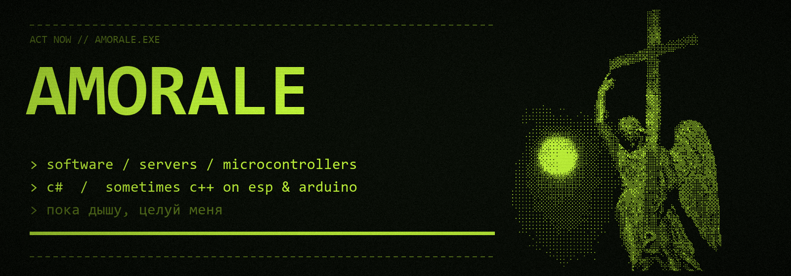

<div align="center">



<sub>`Готов падать — круизная высота`</sub>

</div>

```
> whoami
amorale

> focus
software        desktop, tools, automation
servers         ASP.NET Core backends, services
hardware        microcontrollers: ESP, Arduino

> status
most of the good stuff is private
```

<br>

### `// stack`

<div align="center">


</div>

### `// activity`

<div align="center">


</div>

<br>

<div align="center">
<sub>░▒▓█ пока дышу, целуй меня █▓▒░</sub>
</div>
